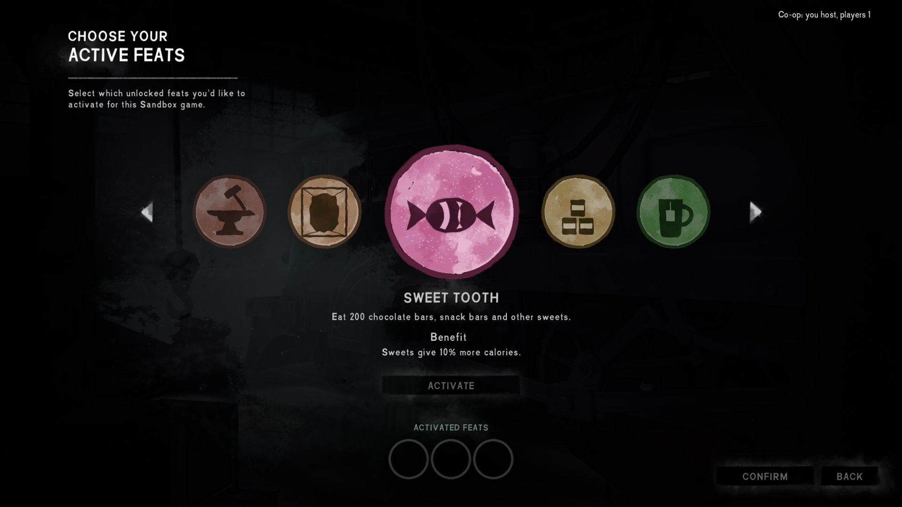

# FeatsByEMPEROR

Новые подвиги для The Long Dark. Новые подвиги со своими значками.

New feats for The Long Dark. New feats with their own badges.

Версия / Version: **0.2.2**. Игра 2.60, MelonLoader 0.7.2 (0.7.3 тоже подходит) / Game 2.60, MelonLoader 0.7.2 (0.7.3 works too).

## Скачать и установить / Download and install

**Проще всего:** лаунчер [TLDModsLauncher.exe](https://github.com/Saderto/TLDCoop/releases/latest/download/TLDModsLauncher.exe). Отметьте **Новые подвиги** и нажмите «Установить / обновить»: он сам
поставит MelonLoader, нужные библиотеки и будет обновлять мод.

**Вручную:** скачайте архив [FeatsByEMPEROR.zip](https://github.com/Saderto/TLDCoop/releases/download/v1.0/FeatsByEMPEROR.zip) и распакуйте его в папку игры `TheLongDark` с заменой файлов.

**Easiest:** the launcher [TLDModsLauncher.exe](https://github.com/Saderto/TLDCoop/releases/latest/download/TLDModsLauncher.exe). Tick **New feats** and press "Install / update": it sets up
MelonLoader and the libraries needed, and keeps the mod updated.

**By hand:** download [FeatsByEMPEROR.zip](https://github.com/Saderto/TLDCoop/releases/download/v1.0/FeatsByEMPEROR.zip) and unpack it into the game folder `TheLongDark`, replacing files.

## Что нужно / Needs

- ничего, кроме MelonLoader.
- nothing but MelonLoader.

## Вопросы и баги / Questions and bugs

Discord: https://discord.gg/ezT7PRZmuS (раздел / category «🧩 Mods / Моды»).

## Сборка / Build

`src/` собирается как остальные моды репозитория (net6.0, MelonLoader, ссылки на игру).
`src/` builds like the other mods of the repo (net6.0, MelonLoader, game refs).
