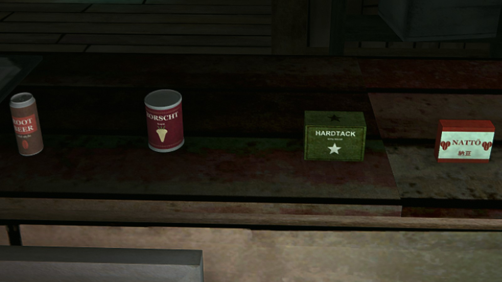

# FoodPackByEMPEROR

Еда и напитки для The Long Dark. Новая еда, напитки и блюда с эффектами; лежат на картах и в контейнерах. Вместе с паком ставится AlcoholMod: напитки пьянят.

Food and drinks for The Long Dark. New food, drinks and dishes with effects, found on maps and in containers. AlcoholMod is installed with it: drinks make you drunk.

Версия / Version: **1.1.1**. Игра 2.60, MelonLoader 0.7.3 / Game 2.60, MelonLoader 0.7.3.

## Скачать и установить / Download and install

**Проще всего:** лаунчер [TLDModsLauncher.exe](https://github.com/Saderto/TLDCoop/releases/latest/download/TLDModsLauncher.exe). Отметьте **Еда и напитки** и нажмите «Установить / обновить»: он сам
поставит MelonLoader, нужные библиотеки и будет обновлять мод.

**Вручную:** скачайте архив [FoodPackByEMPEROR.zip](https://github.com/Saderto/TLDCoop/releases/download/v1.0/FoodPackByEMPEROR.zip) и распакуйте его в папку игры `TheLongDark` с заменой файлов.

**Easiest:** the launcher [TLDModsLauncher.exe](https://github.com/Saderto/TLDCoop/releases/latest/download/TLDModsLauncher.exe). Tick **Food and drinks** and press "Install / update": it sets up
MelonLoader and the libraries needed, and keeps the mod updated.

**By hand:** download [FoodPackByEMPEROR.zip](https://github.com/Saderto/TLDCoop/releases/download/v1.0/FoodPackByEMPEROR.zip) and unpack it into the game folder `TheLongDark`, replacing files.

## Что нужно / Needs

- AfflictionComponent, ModData, ComplexLogger, ModSettings, AlcoholMod (и ModComponent, его требует сам AlcoholMod). С AlcoholMod напитки пьянят.
- AfflictionComponent, ModData, ComplexLogger, ModSettings, AlcoholMod (plus ModComponent, required by AlcoholMod itself). With AlcoholMod drinks make you drunk.

## Вопросы и баги / Questions and bugs

Discord: https://discord.gg/ezT7PRZmuS (раздел / category «🧩 Mods / Моды»).

## Сборка / Build

`src/` собирается как остальные моды репозитория (net6.0, MelonLoader, ссылки на игру).
`src/` builds like the other mods of the repo (net6.0, MelonLoader, game refs).
