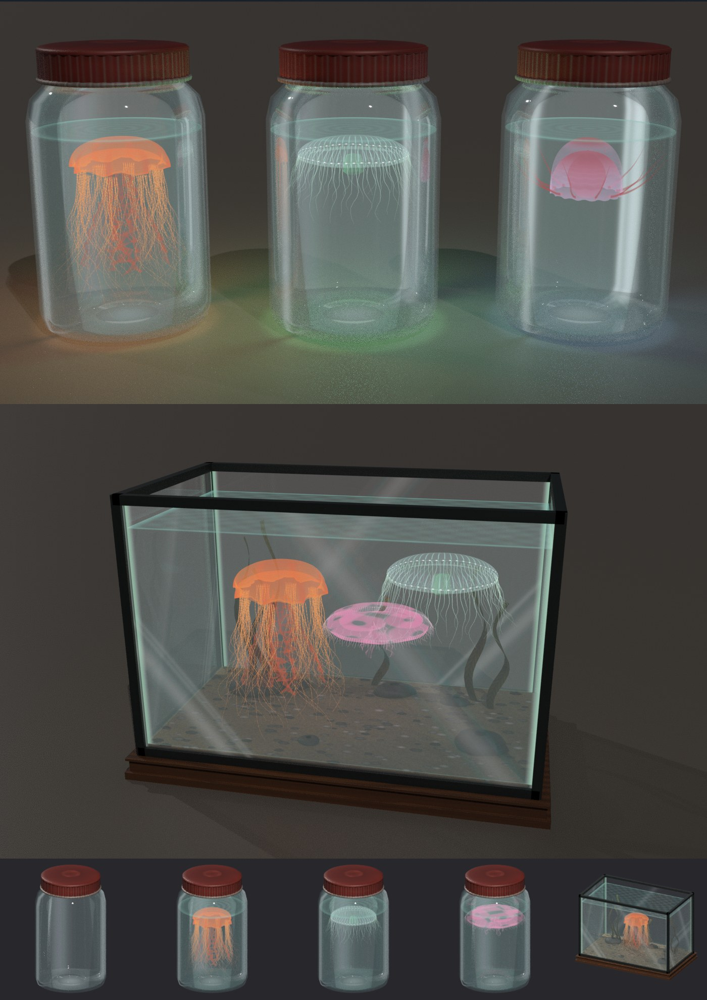

# JellyfishByEMPEROR

Медузы северного моря для The Long Dark: живой декор для дома. Медузу не поймать на крючок, но иногда она всплывает в
новой лунке на морском льду. Её можно зачерпнуть банкой и держать в банке или в аквариуме: там она плавает и светится.
Ни еды, ни наживки, ни выгоды от неё нет, это просто красивая вещь.

Jellyfish of the northern sea for The Long Dark: living decoration for your base. A jellyfish never takes the hook, but sometimes
one floats up in a freshly cut hole on sea ice. Scoop it up with a jar and keep it in the jar or in an aquarium, where it swims
and glows. It gives no food, bait or other benefit: it is just a beautiful thing.

## Как поймать / How to catch one

- Только на морском льду: Coastal Highway, Desolation Point, Bleak Inlet, Forsaken Airfield. В озёрах и реках медуз нет.
- В новой лунке медуза всплывает с шансом 30% и держится 3–7 секунд. Внизу экрана окно: «Зачерпнуть банкой» (1, нужна пустая
  банка в рюкзаке) или «Отпустить» (2).
- Ночью бывает редкая шлемовидная медуза.
- Пустые банки лежат в контейнерах (около 4%, на побережье 10%).

- Only on sea ice: Coastal Highway, Desolation Point, Bleak Inlet, Forsaken Airfield. Lakes and rivers have none.
- A new hole gets a jellyfish with a 30% chance; it stays for 3–7 seconds. A panel at the bottom of the screen offers
  "Scoop with a jar" (1, needs an empty jar in the pack) or "Let go" (2).
- At night a rare helmet jellyfish can come up.
- Empty jars are found in containers (about 4%, 10% on the coast).

## Банка и аквариум / Jar and aquarium

- Банку с медузой ставят из рюкзака кнопкой «Поставить». Медуза плавает, ночью и в помещении светится (светятся до 6 ближайших).
- Аквариум делается на верстаке: 4 пустые банки, 8 металлолома, 4 старые доски, 8 часов. В нём до 3 медуз; переливают из банки
  и забирают обратно банкой в окне аквариума. Забрать или сдвинуть аквариум можно только пустым.
- Ниже −5° вода стынет, и медуза теряет состояние: с полного погибает за 90 игровых минут. В тепле (выше +2°) восстанавливается,
  в рюкзаке ей на 12° теплее, костры и печи рядом греют. Погибшая медуза пропадает, банка остаётся пустой.
- Что плавает в аквариумах, хранится по мирам в `Mods/JellyfishByEMPEROR/saves`.

- Place a jar with a jellyfish from the pack with "Place". The jellyfish swims and glows at night and indoors (the 6 nearest glow).
- The aquarium is made at a workbench: 4 empty jars, 8 scrap metal, 4 reclaimed wood, 8 hours. It holds up to 3 jellyfish;
  pour them in from a jar and take them back with an empty jar in the aquarium window. Only an empty aquarium can be picked up or moved.
- Below −5° the water freezes and the jellyfish loses condition: from full it dies in 90 game minutes. In warmth (above +2°) it
  recovers; in the pack it is 12° warmer, and nearby fires and stoves count. A dead jellyfish disappears and the jar is left empty.
- What swims in which aquarium is saved per world in `Mods/JellyfishByEMPEROR/saves`.

Шесть видов, 20 окрасов, у каждого своя иконка / Six species, 20 colourings, each with its own icon: ушастая аурелия / moon
jellyfish, львиная грива / lion's mane, северная морская крапива / sea nettle, хрустальная медуза / crystal jelly, морской крыжовник /
comb jelly, шлемовидная медуза / helmet jellyfish (только ночью / night only).

## Кооп / Co-op

Нужен **CoopByEMPEROR 0.19.69** или новее, у обоих игроков одни и те же версии. Медузу в лунке видят все рядом, окно ловли
получает каждый в пределах 6 м, забирает нажавший первым (решает хост). Аквариумы у всех одинаковые; действия друга идут через хоста.

Needs **CoopByEMPEROR 0.19.69** or newer, both players on the same versions. Everyone nearby sees the jellyfish in the hole, everyone
within 6 m gets the catch panel, and the first to press gets it (the host decides). Aquariums are the same for everyone; the friend's
actions go through the host.

## Настройки / Settings

`UserData/MelonPreferences.cfg`, раздел / section `[JellyfishByEMPEROR]`:

| Настройка / Setting | По умолчанию / Default | Что делает / What it does |
|---|---|---|
| `Chance` | 30 | Шанс медузы в новой лунке на море, % / Chance of a jellyfish in a new sea hole, % |
| `AnyWater` | false | Медузы и в озёрах / Jellyfish in lakes too |
| `DebugLog` | true | Подробный лог / Detailed log |
| `TestKeys` | false | Тест: Ctrl+Shift+F8 банки и медузы в рюкзак, Ctrl+Shift+F9 медуза перед тобой / Test: Ctrl+Shift+F8 jars and jellyfish into the pack, Ctrl+Shift+F9 a jellyfish in front of you |

Консоль разработчика / developer console: `add jf_jar`, `add jf_aquarium`, `add jf_jelly_lionsmane_amber`.

## Файлы / Files

`Mods/JellyfishByEMPEROR.dll` и папка / and the folder `Mods/JellyfishByEMPEROR` (`meshes`, `textures`, `icons`, `saves`).
Все модели и текстуры сделаны с нуля кодом (`tools/models.py`, `tools/render.py`), из игры ничего не взято. Тексты на русском и английском.
All models and textures are made from scratch by code (`tools/models.py`, `tools/render.py`); nothing is taken from the game. Russian and English texts.
