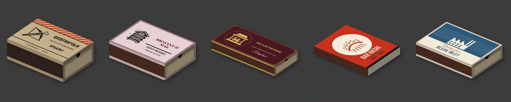

# MatchboxesByEMPEROR

Спичечные коробки с этикетками для The Long Dark: 120 разных этикеток в 12 сериях, которые можно собирать. Коробки лежат
в контейнерах, в руках своя спичка и свой коробок, а собранные этикетки видны в журнале.

Labelled matchboxes for The Long Dark: 120 collectible labels in 12 series. The boxes are found in containers, you hold
our own match and box in your hands, and the labels you have collected show in the journal.

## Коробки / Boxes

| Вид / Kind | Спичек / Matches |
|---|---|
| Обычный коробок / Standard box | 40 |
| Штормовые / Storm matches | 20 |
| Длинные каминные / Long fireplace matches | 25 |
| Спичечная книжка / Matchbook | 20 |
| Сувенирный коробок / Souvenir box | 100 |

- Коробки попадаются в контейнерах, которые обыскиваешь впервые, и часть обычных игровых спичек становится коробком с этикеткой.
  Найденный коробок заполнен на 40–100%.
- На один шкаф или комод приходится одна находка: в соседних дверцах и ящиках одинаковых коробков не бывает. Коробок появляется, когда контейнер открывают в первый раз.
- Что где лежит, зависит от зерна мира, сцены и места, поэтому в кооперативе у обоих игроков одинаково. Напарник видит у тебя
  в руках обычную игровую спичку.
- Собранные этикетки видны в журнале, раздел «Коллекции» → «Спичечные этикетки» (N / 120).

- Boxes turn up in containers you search for the first time, and part of the game's own matches become a labelled box.
  A found box is 40–100% full.
- One find per piece of furniture: the doors and drawers of one cupboard never hold the same box. The box is made when the container is first opened.
- What is found where depends on the world seed, the scene and the spot, so both players get the same in co-op. Your co-op
  partner sees the game's plain match in your hands.
- The labels you have collected are in the journal, under "Collections" → "Matchbox labels" (N / 120).

## Серии / Series

Звери Великого Медведя / Beasts of the Great Bear; Береги лес от пожара! / Protect the forest from fire!; Маяки и суда
побережья / Lights and ships of the coast; Обитатели северных вод / Creatures of northern waters; Зимние игры / Winter games;
Дорога к звёздам / Road to the stars; Спички со всего света / Matches of the world; Бары и чайные Токио / Tokyo bars and tea
rooms; Охотничьи штормовые / Hunter storm matches; Уютный вечер / Hearthside evenings; Привет с Великого Медведя / Greetings
from Great Bear; Закусочные и клубы / Diners and night clubs.

## Настройки / Settings

`UserData/MelonPreferences.cfg`, раздел / section `[MatchboxesByEMPEROR]`:

| Настройка / Setting | По умолчанию / Default | Что делает / What it does |
|---|---|---|
| `LootChance` | 3 | Сколько % впервые обысканных контейнеров получают коробок / % of containers searched for the first time that get a box |
| `ReplaceVanilla` | 40 | Сколько % игровых спичек в контейнерах становятся коробком с этикеткой / % of the game's matches in containers that become a labelled box |
| `FlameRaise` | 2 | На сколько мм пламя выше линии горения спички (меньше нуля: ниже) / How many mm the flame sits above the burning line of the stick (negative: lower) |
| `DebugLog` | false | Подробный лог / Detailed log |
| `TestKeys` | false | Тест: Ctrl+Shift+F8 даёт по коробку каждой этикетки / Test: Ctrl+Shift+F8 gives one box of every label |

## Файлы / Files

`Mods/MatchboxesByEMPEROR.dll` и папка / and the folder `Mods/MatchboxesByEMPEROR` (`matchboxes1.pak`–`matchboxes3.pak`).
Других модов не требует. Файлов игры внутри нет: модели и этикетки сделаны кодом (`tools/`). Тексты на русском и английском.
No other mods needed. There are no game files inside: the models and labels are made by code (`tools/`). Russian and English texts.

Фигуры на этикетках взяты с [game-icons.net](https://game-icons.net) по лицензии
[CC BY 3.0](https://creativecommons.org/licenses/by/3.0/), авторы: Lorc, Delapouite и другие авторы game-icons.net. Фигуры перерисованы под печать на этикетке.
The label figures come from [game-icons.net](https://game-icons.net) under [CC BY 3.0](https://creativecommons.org/licenses/by/3.0/),
by Lorc, Delapouite and the other game-icons.net authors. The figures were redrawn in a printed label style.
