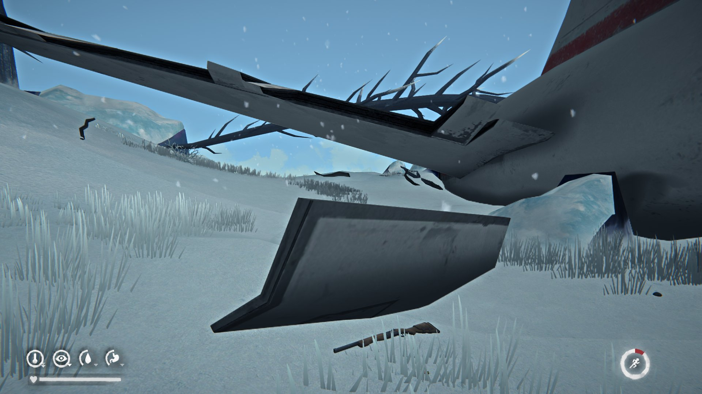

# ShotgunByEMPEROR

Дробовик для The Long Dark. Дробовик из WINTERMUTE в режиме выживания, с патронами и навыком.

Shotgun for The Long Dark. The WINTERMUTE shotgun in survival, with shells and a skill.

Версия / Version: **0.1.35**. Игра 2.60, MelonLoader 0.7.3 / Game 2.60, MelonLoader 0.7.3.

## Скачать и установить / Download and install

**Проще всего:** лаунчер [TLDModsLauncher.exe](https://github.com/Saderto/TLDCoop/releases/latest/download/TLDModsLauncher.exe). Отметьте **Дробовик** и нажмите «Установить / обновить»: он сам
поставит MelonLoader, нужные библиотеки и будет обновлять мод.

**Вручную:** скачайте архив [ShotgunByEMPEROR.zip](https://github.com/Saderto/TLDCoop/releases/download/v1.0/ShotgunByEMPEROR.zip) и распакуйте его в папку игры `TheLongDark` с заменой файлов.

**Easiest:** the launcher [TLDModsLauncher.exe](https://github.com/Saderto/TLDCoop/releases/latest/download/TLDModsLauncher.exe). Tick **Shotgun** and press "Install / update": it sets up
MelonLoader and the libraries needed, and keeps the mod updated.

**By hand:** download [ShotgunByEMPEROR.zip](https://github.com/Saderto/TLDCoop/releases/download/v1.0/ShotgunByEMPEROR.zip) and unpack it into the game folder `TheLongDark`, replacing files.

## Что нужно / Needs

- ничего, кроме MelonLoader.
- nothing but MelonLoader.

Модели и звуки собираются из вашей же игры (эпизод 5 WINTERMUTE должен быть скачан): лаунчер делает это сам, а при ручной установке один раз запустите `Mods\TLDAssets.exe` при закрытой игре.

The models and sounds are built from your own game (episode 5 WINTERMUTE must be downloaded): the launcher does it, and after a manual install run `Mods\TLDAssets.exe` once with the game closed.

## Кооп / Co-op

Работает вместе с [CoopByEMPEROR](../CoopByEMPEROR): у обоих игроков должны стоять одни и те же моды и версии.
Works with [CoopByEMPEROR](../CoopByEMPEROR): both players must run the same mods and versions.

## Вопросы и баги / Questions and bugs

Discord: https://discord.gg/ezT7PRZmuS (раздел / category «🧩 Mods / Моды»).

## Сборка / Build

`src/` собирается как остальные моды репозитория (net6.0, MelonLoader, ссылки на игру).
`src/` builds like the other mods of the repo (net6.0, MelonLoader, game refs).
