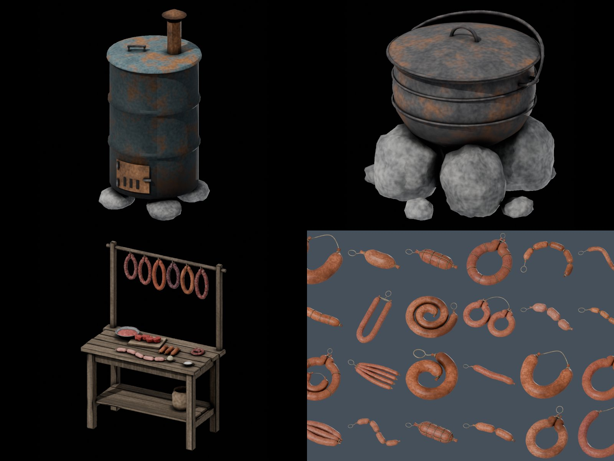
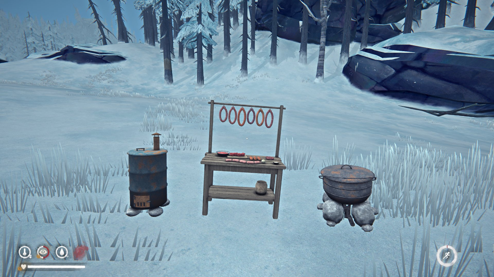

# SmokehouseByEMPEROR

Коптильня и заготовки для The Long Dark: бочка-коптильня, котёл для консервов и стол для колбас. Мясо и рыба коптятся
горячим или холодным способом, консервы варятся в котле, колбасы делаются на столе и потом коптятся в бочке.

A smokehouse and preserves for The Long Dark: a barrel smokehouse, a canning kettle and a sausage table. Meat and fish are
hot or cold smoked, cans are boiled in the kettle, sausages are made at the table and then smoked in the barrel.

## Станции / Stations

Всё делается на верстаке. Начатую станцию можно бросить: она остаётся предметом «недостроенная …», и на верстаке её
доделывают за оставшиеся часы без новых материалов.

| Станция | Материалы | Время |
|---|---|---|
| Бочка-коптильня | 30 металлолома, 6 старых досок, 6 ткани, 4 камня, ножовка | 64 ч |
| Котёл для консервов | 15 металлолома, 4 камня, ножовка | 24 ч |
| Стол для колбас | 8 старых досок, 4 металлолома, 2 ткани | 12 ч |

Everything is made at a workbench. A station left half-built stays in the pack as an "unfinished …" item and is finished at
a workbench for the hours that are left, with no new materials.

| Station | Materials | Time |
|---|---|---|
| Barrel smokehouse | 30 scrap metal, 6 reclaimed wood, 6 cloth, 4 stones, hacksaw | 64 h |
| Canning kettle | 15 scrap metal, 4 stones, hacksaw | 24 h |
| Sausage table | 8 reclaimed wood, 4 scrap metal, 2 cloth | 12 h |

Бочку и котёл разжигают только на улице. Забрать или передвинуть станцию можно только пустой и холодной.

The barrel and the kettle are lit outdoors only. A station can be picked up or moved only when it is empty and cold.

## Коптильня / Smokehouse

- 6 мест. Горячее копчение 32 часа, холодное 52 часа (нужна готовка 4 уровня). Нужны дрова и соль.
- Горячее копчёное портится намного медленнее жареного, холодное копчёное не портится совсем.
- Коптятся все виды мяса и рыбы из игры и сырые колбасы со стола.
- Соль показана в граммах.

- 6 places. Hot smoking takes 32 hours, cold smoking 52 hours (needs Cooking level 4). It burns firewood and takes salt.
- Hot-smoked food spoils much slower than cooked food; cold-smoked food never spoils.
- Every meat and fish of the game can be smoked, and so can raw sausages from the table.
- Salt is shown in grams.

## Котёл и консервы / Kettle and cans

- 6 мест, крышка, пар и свой звук кипения. Банка консервов варится 24 часа, в неё идёт 0,3 кг мяса или рыбы.
- 15 видов консервов. Из одного мяса: оленина, лосятина, медвежатина, волчатина, пума, паштет из дичи (заяц или куропатка),
  рыба, лосось (кижуч или форель), морская рыба. Сборные: охотничья тушёнка (оленина и лосятина), рагу из дичи, тушёнка
  зверобоя, рыбацкая похлёбка, «Великий Медведь» (оленина, лосятина и медвежатина), рыбное ассорти (три разные рыбы).
- Консервы не портятся, пустая банка остаётся в рюкзаке. Рецепты в окне котла листаются по страницам.
- Звук кипения сделан через звук Unity: он слышен, если стоит плагин SmokesAudioOn (есть в релизе).

- 6 places, a lid, steam and its own boiling sound. A can boils for 24 hours and takes 0.3 kg of meat or fish.
- 15 kinds of cans. From one meat: venison, moose, bear, wolf, cougar, game pâté (rabbit or ptarmigan), fish, salmon
  (coho or trout), sea fish. Mixed: hunter's (venison and moose), game stew, beastslayer's, angler's chowder, Great Bear
  (venison, moose and bear), fish medley (three different fish).
- Cans never spoil; the empty can stays in the pack. The kettle's recipe list has pages.
- The boiling sound plays through Unity audio: it is heard when the SmokesAudioOn plugin is installed (it is in the release).

## Колбасы / Sausages

- На столе из мяса (0,5 кг), кишки и соли делается сырая колбаса. Работа идёт со временем, как крафт. Мясо, кишка и соль
  тратятся, только когда колбаса готова: если прервать работу, ничего не пропадёт.
- Нужен уровень кулинарии: колбаса из одного мяса 1, из двух 2, из трёх 3, из четырёх 4, рыбная из всех рыб 5.
- 24 вида колбас: из одного мяса или рыбы и сборные из нескольких. У каждой свой эффект, кроме обычной долгой сытости.
- Колбасы только коптятся: горячего копчения или сыровяленые (холодное копчение).
- Окно коптильни показывает панель рецептов.

- At the table, meat (0.5 kg), a gut and salt make a raw sausage. The work takes time, as crafting does. The meat, gut and
  salt are spent only when the sausage is done: breaking the work off costs nothing.
- Sausages need a Cooking level: one meat 1, two 2, three 3, four 4, the all-fish sausage 5.
- 24 kinds of sausage: from one meat or fish, and mixed ones of several. Each has its own effect on top of the usual
  long satiety.
- Sausages are only smoked: hot smoked or dry (cold smoked).
- The smokehouse window shows a recipes panel.

## Прочее / Other

- Копчёное мясо и рыба (но не консервы и не колбасы) бывают у Торговца (DLC Tales).
- Состояние бочек и котлов хранится по мирам в `Mods/SmokehouseByEMPEROR/saves`. Старая папка `SmokehouseBySeagull`
  переносится сама при первом запуске.
- Ctrl+Shift+F8 (тестовые предметы) работает, только если в настройках включено TestKeys; по умолчанию выключено.

- Smoked meat and fish (not the cans or sausages) can show up at the Trader (Tales DLC).
- The state of barrels and kettles is kept per world in `Mods/SmokehouseByEMPEROR/saves`. An old `SmokehouseBySeagull`
  folder is moved over by itself on the first start.
- Ctrl+Shift+F8 (test items) works only when TestKeys is turned on in the settings; it is off by default.

## Сборка / Build

`src/` собирается как остальные моды репозитория (net6.0, MelonLoader, ссылки на игру 2.58 и `UnityEngine.AudioModule`).
`tools/` и `blender/` строят модели, текстуры и значки.

`src/` builds like the other mods of the repo (net6.0, MelonLoader, game 2.58 refs and `UnityEngine.AudioModule`).
`tools/` and `blender/` build the models, textures and icons.
