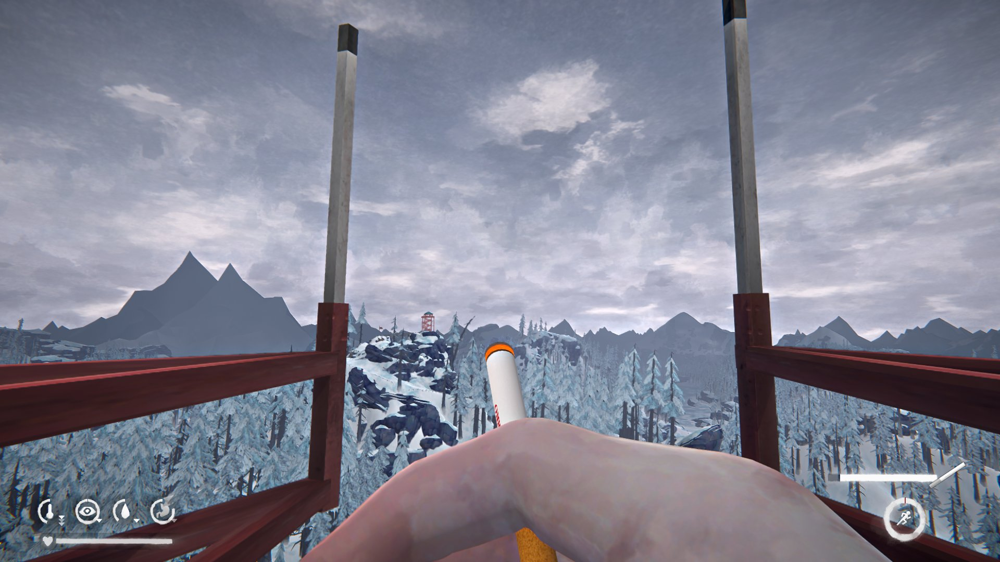

# SmokesByEMPEROR

Сигареты и трубки для The Long Dark. Сигареты, сигары, сигариллы, трубки, табак и зажигалки со своими звуками и эффектами. Плагин звука SmokesAudioOnByEMPEROR входит в архив.

Smokes for The Long Dark. Cigarettes, cigars, cigarillos, pipes, tobacco and lighters with their own sounds and effects. The SmokesAudioOnByEMPEROR sound plugin is included.

Версия / Version: **0.1.147**. Игра 2.60, MelonLoader 0.7.3 / Game 2.60, MelonLoader 0.7.3.

## Скачать и установить / Download and install

**Проще всего:** лаунчер [TLDModsLauncher.exe](https://github.com/Saderto/TLDCoop/releases/latest/download/TLDModsLauncher.exe). Отметьте **Сигареты и трубки** и нажмите «Установить / обновить»: он сам
поставит MelonLoader, нужные библиотеки и будет обновлять мод.

**Вручную:** скачайте архив [SmokesByEMPEROR.zip](https://github.com/Saderto/TLDCoop/releases/download/v1.0/SmokesByEMPEROR.zip) и распакуйте его в папку игры `TheLongDark` с заменой файлов.

**Easiest:** the launcher [TLDModsLauncher.exe](https://github.com/Saderto/TLDCoop/releases/latest/download/TLDModsLauncher.exe). Tick **Smokes** and press "Install / update": it sets up
MelonLoader and the libraries needed, and keeps the mod updated.

**By hand:** download [SmokesByEMPEROR.zip](https://github.com/Saderto/TLDCoop/releases/download/v1.0/SmokesByEMPEROR.zip) and unpack it into the game folder `TheLongDark`, replacing files.

## Что нужно / Needs

- AfflictionComponent (и ComplexLogger, ModData, ModSettings, их требует сам AfflictionComponent); плагин `SmokesAudioOnByEMPEROR.dll` в папке `Plugins` (есть в архиве).
- AfflictionComponent (plus ComplexLogger, ModData and ModSettings, required by AfflictionComponent itself); the `SmokesAudioOnByEMPEROR.dll` plugin in `Plugins` (included in the archive).

## Вопросы и баги / Questions and bugs

Discord: https://discord.gg/ezT7PRZmuS (раздел / category «🧩 Mods / Моды»).

## Сборка / Build

`src/` собирается как остальные моды репозитория (net6.0, MelonLoader, ссылки на игру).
`src/` builds like the other mods of the repo (net6.0, MelonLoader, game refs).
