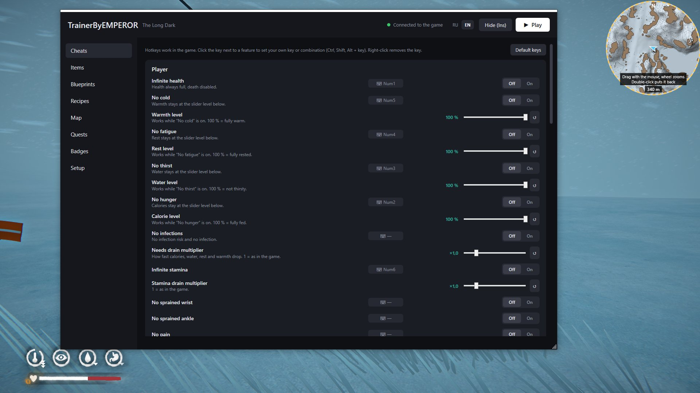

# TrainerByEMPEROR — трейнер для The Long Dark

Отдельное приложение в стиле Wand/WeMod. В окне есть переключатели Off/On, ползунки, выбор погоды, открытие чертежей и выдача любых предметов.

## Как это устроено

Окно трейнера (`TrainerByEMPEROR.exe`) — обычная программа для Windows. Кнопкой «Установить» оно кладёт в игру загрузчик модов MelonLoader и свой небольшой модуль `Mods/TrainerByEMPEROR.dll`. Модуль загружается вместе с игрой и выполняет команды, которые присылает окно: включить бессмертие, выдать 5 спичек и т.п. Wand устроен так же, только внедряет свой модуль при каждом запуске.

Связь идёт только внутри вашего компьютера (127.0.0.1, порт 47811). В интернет трейнер выходит один раз: чтобы скачать MelonLoader 0.7.1 с GitHub при установке.

Сделано под версию игры **2.55** (Steam или Epic, Windows).

## Язык / Language

Вверху окна есть переключатель **RU / EN**: язык окна, подсказок, карты и названий мест. Выбор сохраняется в настройках трейнера и
передаётся модулю в игре. Пока язык не выбран, он берётся из языка Windows. Названия предметов идут из самой игры, поэтому они на языке игры.

The **RU / EN** switch at the top of the window sets the language of the window, hints, map and place names. The choice is saved in the
trainer's settings and sent to the in-game module. Until you pick one, the Windows language is used. Item names come from the game itself,
so they follow the game's language.

## Быстрый старт

**Проще всего:** поставьте трейнер лаунчером `TLDModsLauncher.exe` (галочка «Трейнер»). Он положит мод в `Mods`, а программу в `Mods\TrainerByEMPEROR`, и трейнер будет открываться прямо в игре по Ins. Вручную: распакуйте `TrainerByEMPEROR.zip` в папку игры.

1. Закройте Wand, если он открыт.
2. Запустите `TrainerByEMPEROR.exe`. Если Windows попросит установить .NET Desktop Runtime 8, согласитесь: это бесплатный компонент Microsoft. Windows может показать предупреждение SmartScreen («Неизвестный издатель»): нажмите «Подробнее» → «Выполнить в любом случае». Так бывает с любой программой без цифровой подписи.
3. Откройте раздел **«Установка»**. Трейнер сам ищет игру в Steam и Epic, а если не нашёл, нажмите «Выбрать tld.exe…». Нажмите **«Установить / обновить»**.
4. Нажмите **«▶ Играть»**. Первый запуск после установки MelonLoader идёт дольше обычного (1–3 минуты), это нормально.
5. Загрузите сохранение. Когда индикатор вверху станет зелёным («Подключено к игре»), переключатели работают.

## Разделы

**Читы** — все функции по группам:

* **Игрок:** бесконечное здоровье, без холода, усталости, жажды и голода, без заражений, растяжений запястья и лодыжки, без боли; бесконечная выносливость; множители расхода показателей, выносливости и получаемого урона; вылечить всё и восстановить всё.
* **Инвентарь:** бесконечный переносимый вес и ползунок максимального веса, бесконечные расходники, бесконечная прочность, бесконечное топливо для света, лёгкий и мгновенный крафт, починить инвентарь.
* **Навыки:** все навыки на максимум.
* **Оружие:** выдать всё оружие и патроны, бесконечные патроны, убийство с одного попадания, без осечек и заклинивания.
* **Животные:** невидимость для животных.
* **Игра:** скорость игры, установка времени суток, остановка времени, без метелей, выбор погоды, быстрое сохранение, не удалять сохранение при смерти.
* **Физика:** суперскорость с множителем, режим полёта с регулировкой скорости.

**Предметы** — все предметы игры по группам (оружие, одежда, еда, медицина, розжиг, инструменты, материалы, прочее), с поиском. Кнопки «+1», «+5», «+10» сразу кладут предмет в инвентарь. Список берётся прямо из вашей игры, поэтому названия на языке игры. При первом открытии игра собирает его около минуты, потом он сохраняется.

**Чертежи** — список всех чертежей с отметкой «открыт / закрыт». Можно открыть любой по отдельности или все сразу.

**Значки** — всё из игрового меню «Значки»: значки испытаний (Спасение, Затравленный, Белая мгла, Кочевник, Архивариус, Мертвец, ивентовые и «Байки из дальних земель») и подвиги (Книжный червь, Мастер огня, Свободный бегун и другие). У каждого видно, получен ли он; кнопка «Выдать» открывает один, «Выдать все» — весь список сразу. Работает и из главного меню. Всё записывается в профиль игры, забрать обратно трейнер не может. Открытые подвиги выбираются при создании нового сохранения, как обычно.

**Уровень голода, жажды, усталости и холода.** У читов «Без голода», «Без жажды», «Без усталости» и «Без холода» есть ползунки уровня от 0 до 100 %. Пока чит включён, показатель держится на выбранном уровне, а не только на максимуме. 100 % значит как раньше: полностью сыт, напоён, отдохнул и согрет.

**Поверх игры** — во время игры трейнер не нужен отдельным окном: нажмите Ins прямо в игре, и окно трейнера появится над игрой, ещё раз Ins (или кнопка «Скрыть») — спрячется, и управление вернётся в игру. Игра под трейнером не сворачивается и продолжает идти: видно всё, что происходит. Для этого трейнер переводит игру из «эксклюзивного» полноэкранного режима в полноэкранный оконный (выглядит так же). Когда игра запущена, окно трейнера само прячется и открывается клавишей. Закрыть трейнер можно, когда игра выключена.

**Навыки** — в разделе «Читы» → «Навыки» есть панель: у каждого навыка видно текущий уровень («3 из 5») и кнопки −1 и +1, которые сразу меняют уровень на один.

Клавиши «поверх игры» и мини-карты трейнер ловит двумя способами: через Windows и через мод внутри игры. Поэтому они работают, даже если игра или Steam запущены от имени администратора, а трейнер нет. Если в этом случае окно трейнера появилось, но не стало активным, щёлкните по нему мышью.

Окно трейнера поверх игры можно перетащить мышью за верхнюю полосу, например на второй монитор. Размер окна меняется, если потянуть за край или уголок справа внизу. Трейнер запомнит место и размер, а двойной щелчок по полосе вернёт окно в центр игры и к обычному размеру. Пока трейнер открыт поверх игры, мини-карта тоже видна и обведена жёлтым пунктиром: её можно перетащить мышью, колесом мыши над ней меняется масштаб (от 40 до 600 м от центра до края), двойной щелчок возвращает её в угол игры. Масштаб есть и ползунком в Установка → «Поверх игры». Звери на мини-карте показаны мордами в цветных кружках: волк, медведь, олень, лось, кролик, пума (крупная кошка), куропатка.

**Запуск прямо из игры.** Отдельно открывать трейнер не нужно. Мод трейнера сам запускает его в фоне при старте игры, а если трейнера нет, то запускает по нажатию Ins прямо в игре, и окно сразу открывается поверх игры. Когда игра закрывается, такой трейнер закрывается тоже. Мод ищет TrainerByEMPEROR.exe в папке игры Mods\TrainerByEMPEROR\, а если вы хоть раз открывали трейнер из другой папки, то там, откуда открывали. Если трейнер уже открыт вручную, второй не запускается. Фоновый запуск при старте игры выключается в Установка → «Поверх игры» → «Запускать трейнер вместе с игрой».

**Мини-карта** — круглая карта в правом верхнем углу экрана игры: карта местности вокруг вас (около 160 м во все стороны), север сверху, стрелка — вы и направление взгляда, значки зданий, пещер, переходов, ориентиров, костров и кроватей, оранжевые точки — животные. Включается и выключается клавишей Home прямо в игре. Мышь и клавиатуру она не перехватывает. Видна, только пока активна игра.

Клавиши для трейнера и мини-карты, включение мини-карты и автоскрытие окна настраиваются в разделе «Установка» → «Поверх игры».

**Мод FoodPack.** Если установлен FoodPackByEMPEROR, его еда и напитки, саке, пачки чая и кофе и карточки рецептов видны во вкладке «Предметы» в отдельных группах «FoodPack: …» с русскими названиями, и их можно выдавать. Его рецепты видны во вкладке «Рецепты», их можно открывать и выдавать готовое блюдо. Список читается прямо из файлов мода, поэтому новые блюда появляются сами после обновления мода. На карте отдельный слой «FoodPack: саке, виски и карточки» показывает 🍶 саке, 📜 карточки, 🥃 виски O'Kerrigan и 🧁 взбитые сливки в текущей локации, ровно там, где они лежат в вашем мире. Серым отмечено то, что уже подобрано.

**Рецепты** — блюда из книги рецептов игры: рагу егеря, пирог ловчего и остальные. У каждого рецепта видны ингредиенты, нужный уровень навыка готовки и отметка, готовили ли его уже. Кнопка «Открыть» добавляет рецепт в книгу (сохраняется вместе с игрой), «Открыть все» открывает все сразу, «Выдать блюдо» кладёт готовое блюдо в инвентарь. Поиск ищет и по названию, и по ингредиентам.

**Карта** — карта текущей локации сверху. По умолчанию подложкой служит нарисованная карта региона из самой игры, целиком и без тумана (переключатель «Карта из игры» на верхней панели). Если у локации нет карты в игре (например, в помещении или в локациях из модов вроде The Long Development) или окно карты игры ещё ни разу не открывалось, трейнер показывает свою схему рельефа. Схему рельефа трейнер строит прямо в игре в фоне: через несколько секунд после загрузки локации карта собирается понемногу в каждом кадре, так что игра не замирает, даже если раздел карты не открыт. Пока карта строится, в окне виден процент готовности. Оттенок показывает высоту, тени — склоны, тонкие линии — горизонтали через 25 м, зелёным отмечен лес, коричневым с тёмным контуром — постройки, скалы и другие объекты, голубым — лёд и вода. В помещении видна планировка этажа. На нём стрелка — это вы, острие показывает, куда вы смотрите. По умолчанию карта выглядит как карта в игре: только её значки и надписи (без сотен значков ресурсов вроде веток и рогоза). Значки карты игры разделены на два фильтра: «здания, пещеры, помещения» и «надписи и ориентиры», так что можно оставить только здания и пещеры. В правом верхнем углу карты есть панель «Фильтры» с несколькими группами, которые добавляют метки трейнера: ещё здания и пещеры, которых нет на карте игры; переходы в другие локации; животные; костры, кровати, верстаки и верёвки; саке, виски и карточки FoodPack; добыча (контейнеры, туши, растения, лут). У каждой группы видно число найденных меток, есть кнопки «Все» и «Ничего», выбор запоминается. Метки трейнера, кроме зверей, собираются один раз при входе в локацию и раз в две минуты, а кнопка «Обновить метки» собирает их заново сразу, так что карта не нагружает игру. Щелчок по любой точке телепортирует туда, если включён переключатель «Телепорт по щелчку» на верхней панели карты (когда он выключен, щелчок ничего не делает), колесо мыши меняет масштаб, карту можно двигать, зажав левую или правую кнопку мыши; при наведении на метку появляется её название, «К себе» возвращает к вашей позиции. В помещении показывается текущий этаж. Если вы перешли в другую локацию, карта переснимется сама. Телепорт работает в пределах текущей локации. Когда подложкой служит карта из игры, метки рисуются так же, как на угольной карте: значки зданий, пещер и ориентиров берутся прямо из игры, а под ними углём подписано название места так, как его пишет игра (например, «Дом на холме», а не технические имена). Слой «Названия мест с карты игры» показывает подписи, которые игра пишет на своей карте. На улице он ставит вас на самую верхнюю поверхность в выбранной точке (землю, скалу или крышу), пропуская деревья, поэтому под текстуры не провалиться.

**Задания** — все активные задания: в выживании это все линейки «Сказаний», в сюжете — текущие главы. У каждого задания виден список задач. Можно завершить любую задачу по отдельности или задание целиком. Трейнер использует для этого встроенные команды разработчиков игры. Перед этим лучше сделать копию сохранения: задания со сложной логикой иногда ведут себя непредсказуемо, если пропустить шаг.

**Установка** — папка игры, состояние MelonLoader и модуля, установка, обновление и удаление.

## Горячие клавиши в игре

Клавиши работают, когда активно окно игры. Любой функции с переключателем или кнопкой «Применить» можно назначить свою клавишу или сочетание: в разделе «Читы» щёлкните по кнопке с клавишей рядом с функцией и нажмите нужное, например `Ctrl + Shift + H`. Правый щелчок убирает клавишу, Esc отменяет назначение. Кнопка «Клавиши по умолчанию» возвращает всё как было. Если сочетание уже занято другой функцией, оно переходит к новой.

По умолчанию (NumLock должен быть включён):

| Клавиша | Функция |
|---|---|
| Num1 | Бесконечное здоровье |
| Num2 | Без голода |
| Num3 | Без жажды |
| Num4 | Без усталости |
| Num5 | Без холода |
| Num6 | Бесконечная выносливость |
| Num7 | Бесконечный переносимый вес |
| Num8 | Бесконечная прочность |
| Num9 | Бесконечные патроны |
| Num0 | Невидимость для животных |
| Num. | Режим полёта (WASD, Space вверх, Ctrl вниз, Shift быстрее) |
| Num+ | Восстановить всё |
| Num− | Вылечить все болезни |

## Если что-то не работает

* Индикатор не становится зелёным: проверьте раздел «Установка» (оба пункта должны быть зелёными) и перезапустите игру.
* Подробный лог игры и модуля: файл `MelonLoader/Latest.log` в папке игры. Пришлите его, и я поправлю.
* Игра может пометить сохранение как «с читами», и достижения в нём могут не засчитываться. Для экспериментов сделайте копию сохранения.
* «Бесконечные патроны»: если разрядить оружие, пока функция включена, патроны в нём не уменьшаются.
* «Бесконечные расходники»: пока функция включена, штучные предметы не тратятся. Это может мешать отдавать предметы по заданиям, на это время её лучше выключить.
* Полёт: при выключении персонаж падает с текущей высоты, но урона от падения в первые 5 секунд нет.
* Удалить трейнер из игры: раздел «Установка» → «Удалить трейнер из игры». Чтобы убрать и MelonLoader, удалите в папке игры `version.dll` и папку `MelonLoader`.

## Сборка из исходников (по желанию)

Нужен .NET SDK 8 (https://dotnet.microsoft.com/download/dotnet/8.0). В папке с исходниками запустите `build.cmd`, готовый файл появится в `publish\TrainerByEMPEROR.exe`.

* `Shared/` — общий список функций (названия, диапазоны, горячие клавиши).
* `Mod/` — модуль для игры (MelonLoader). Сборки игры подтягиваются из NuGet (`STBlade.Modding.TLD.Il2CppAssemblies.Windows`). После обновления игры поднимите версию этого пакета в `Mod/TrainerByEMPEROR.csproj`.
* `App/` — окно трейнера (WPF, .NET 8). Модуль встраивается в .exe при сборке.
